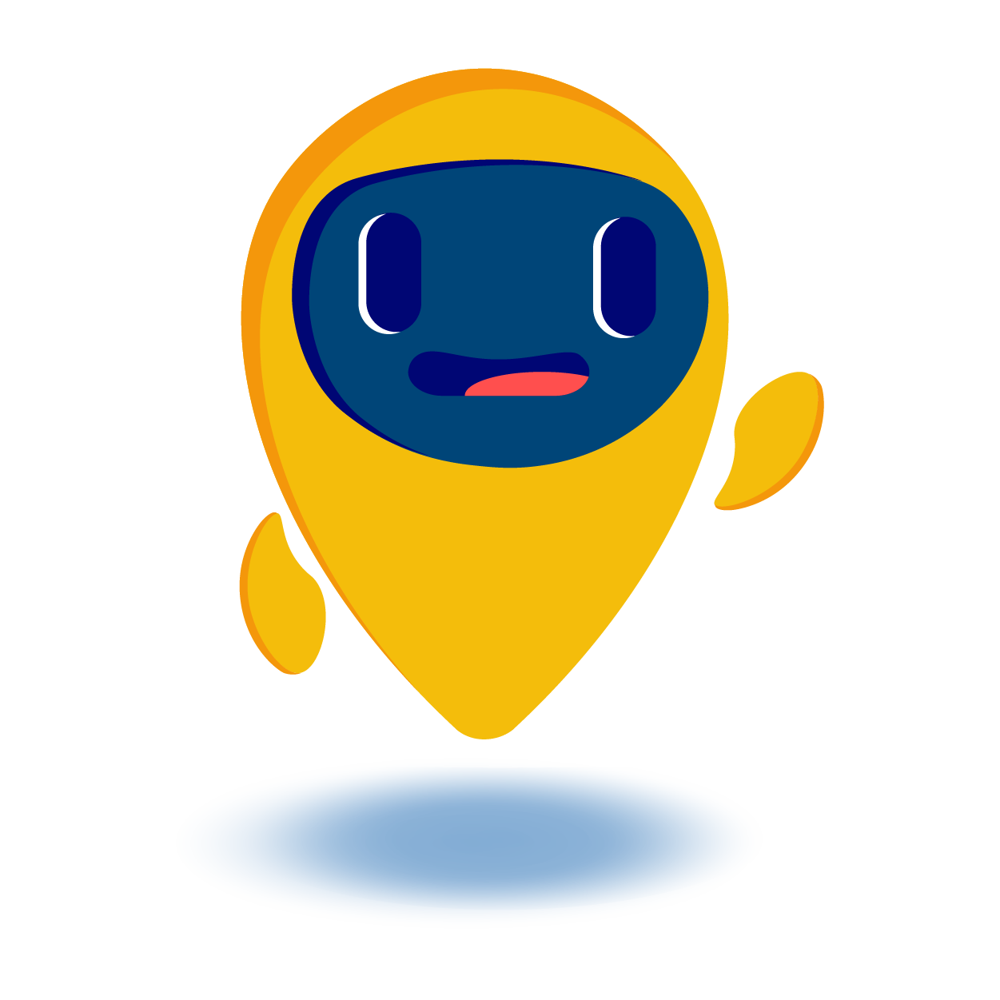
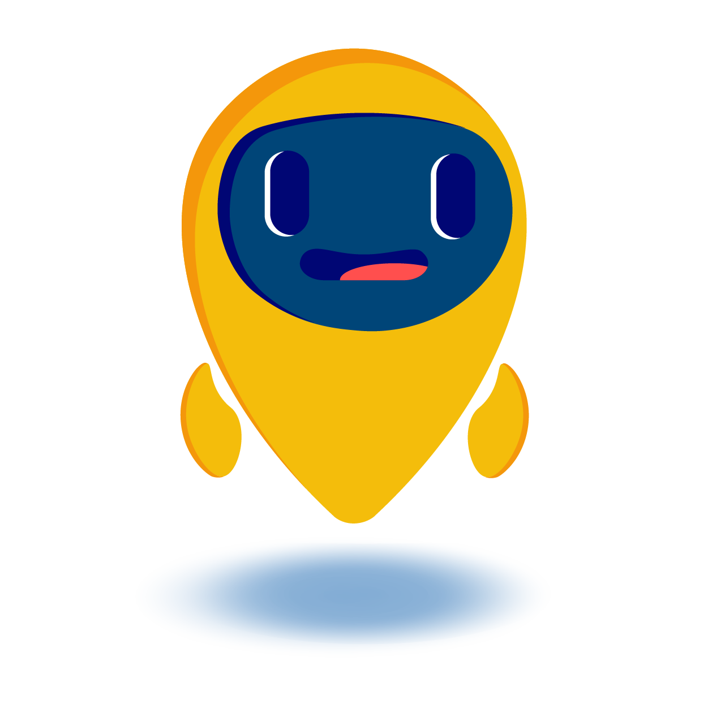
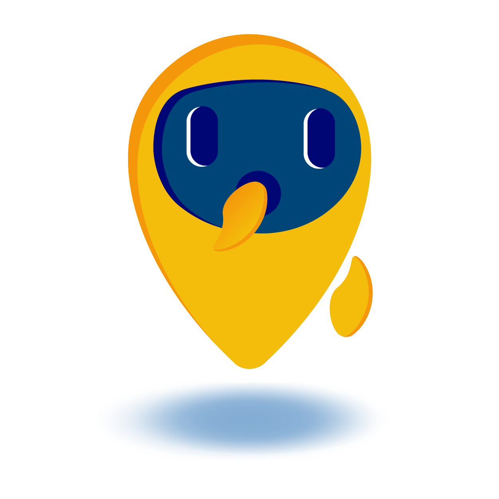
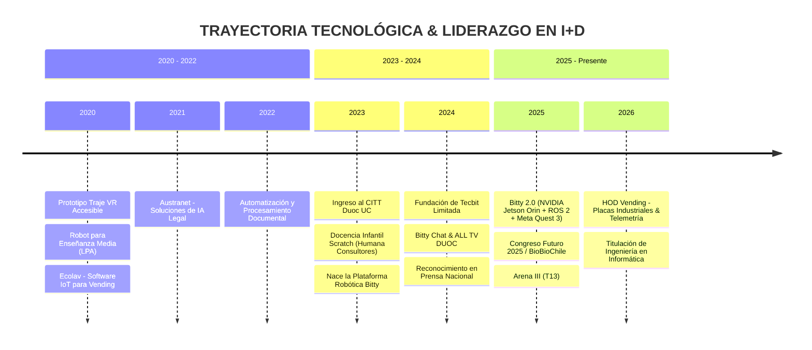

<div align="center">

<!-- HERO BANNER: IRON MAN HUD + FRUTIGER AERO + BITTY AI COPILOT -->


<br>

<!-- ACTION HUBS: PORTFOLIO, LINKEDIN, CVS & CONTACT -->
<p align="center">
  <a href="https://ethan.tecbit.cl" target="_blank">
    
  </a>
  <a href="https://www.linkedin.com/in/ethanleiva/" target="_blank">
    
  </a>
  <a href="mailto:ethant.leiva@gmail.com">
    
  </a>
</p>

<!-- CV DOWNLOAD HUD BADGES -->
<p align="center">
  <a href="docs/CV_Ethan_Leiva_Pardo_Full_Stack_ES.pdf" download>
    
  </a>
  &nbsp;&nbsp;
  <a href="docs/Ethan_Leiva_Pardo_Robotics_AI_IoT_RnD_CV.pdf" download>
    
  </a>
  &nbsp;&nbsp;
  <a href="docs/CV_Ethan_Leiva_Pardo.pdf" download>
    
  </a>
</p>

<!-- HOLOGRAPHIC HUD DIVIDER -->


</div>

<br>

<!-- BITTY CO-PILOT TERMINAL BRIEFING -->
<div align="center">
  
</div>

<br>

<!-- TELEMETRY METRIC HUD CARDS -->
<table align="center" width="100%">
  <tr>
    <td align="center" width="25%" style="background-color: #071936; border: 1px solid #00f2fe; border-radius: 12px; padding: 14px;">
      <font color="#00f2fe" size="4"><b>🚀 +5 AÑOS I+D</b></font><br>
      <font color="#b8d7f5" size="2">Ingeniería &amp; Prototipado de Punta a Punta</font>
    </td>
    <td align="center" width="25%" style="background-color: #071936; border: 1px solid #00f5d4; border-radius: 12px; padding: 14px;">
      <font color="#00f5d4" size="4"><b>⚡ +60% EFICIENCIA</b></font><br>
      <font color="#b8d7f5" size="2">Optimización &amp; -25% Costos en Tecbit</font>
    </td>
    <td align="center" width="25%" style="background-color: #071936; border: 1px solid #ffb703; border-radius: 12px; padding: 14px;">
      <font color="#ffb703" size="4"><b>🤖 BITTY 2.0 LEAD</b></font><br>
      <font color="#b8d7f5" size="2">Robótica Social · ROS 2 · Jetson · LLMs</font>
    </td>
    <td align="center" width="25%" style="background-color: #071936; border: 1px solid #4facfe; border-radius: 12px; padding: 14px;">
      <font color="#4facfe" size="4"><b>🔬 HARDWARE DIAG.</b></font><br>
      <font color="#b8d7f5" size="2">Microelectrónica &amp; Vending en HOD</font>
    </td>
  </tr>
</table>

<br>

<div align="center">
  
</div>

## `// 01. CORE DIAGNOSTICS & PERFIL OPERATIVO` 🛰️

```yaml
SYS_ENGINEER: "Ethan Leiva Pardo"
TITLE: "Ingeniero en Informática (Titulado) | Duoc UC (Antonio Varas) · Formación Inicial USM"
CORE_SPECIALTIES:
  - "Robotics & Edge AI Engineer (ROS 2, NVIDIA Jetson Orin, OpenCV, Local LLMs)"
  - "Full Stack Software Architect (React, TypeScript, Node.js, FastAPI, NestJS, Laravel)"
  - "IoT & Industrial Automation (ESP32, MQTT, WebSockets, Node-RED, Telemetría)"
  - "Industrial Board Diagnostics & Repair (HOD Vending)"
ENTERPRISE_ROLE: "Cofundador & Director de Proyectos Tecnológicos en Tecbit Limitada"
LOCATION: "Santiago, Chile // Lat 33°26'S, Lon 70°39'W"
DIRECTIVE: "Transformar problemas complejos en soluciones de hardware y software con impacto real"
STATUS: "CORE STABLE // OPEN TO STRATEGIC ALLIANCES & R&D CHALLENGES"
```

> **Ingeniero en Informática titulado** con más de 5 años de trayectoria diseñando y desplegando soluciones tecnológicas integrales que abarcan desde **software de misión crítica en la nube** hasta **robótica autónoma**, **inteligencia artificial en el edge** y **diagnóstico electrónico de hardware industrial**.
>
> Creador principal de **Bitty**, una plataforma robótica de asistencia e impacto social que integra **ROS 2, NVIDIA Jetson Orin, ESP32, visión por computador, modelos de lenguaje locales (LLM) y realidad virtual con Meta Quest 3**, con apariciones destacadas en el **Congreso Futuro 2025** (BioBioChile) y **T13 en Arena III Duoc UC**.

<br>

<div align="center">
  
</div>

## `// 02. TECH ARSENAL & NEURAL STACK` ⚡

<table>
  <tr>
    <td width="50%" valign="top">
      <h3>🤖 Robótica, Edge AI & Visión Computacional</h3>
      <p>
        
        
        
        
        
        
        
        
        
      </p>
    </td>
    <td width="50%" valign="top">
      <h3>💻 Full Stack Web & Mobile Architecture</h3>
      <p>
        
        
        
        
        
        
        
        
        
        
      </p>
    </td>
  </tr>
  <tr>
    <td width="50%" valign="top">
      <h3>☁️ Cloud, DevOps & Servidores</h3>
      <p>
        
        
        
        
        
        
        
      </p>
    </td>
    <td width="50%" valign="top">
      <h3>📡 IoT, Telemetría & Hardware Industrial</h3>
      <p>
        
        
        
        
        
        
      </p>
    </td>
  </tr>
  <tr>
    <td colspan="2">
      <h3>🗄️ Bases de Datos & Almacenamiento Distribuido</h3>
      <p align="center">
        
        
        
        
        
        
      </p>
    </td>
  </tr>
</table>

<br>

<div align="center">
  
</div>

## `// 03. SPECIAL MISSIONS & DEPLOYED PLATFORMS` 🛸

<table width="100%">
  <tr>
    <td width="15%" align="center" valign="middle">
      
    </td>
    <td width="85%">
      <h3>🤖 Bitty 2.0 — Plataforma Robótica Social con IA & Visión</h3>
      <p>
        Robot asistente autónomo concebido en el <b>CITT Duoc UC</b> para interacción humano-robot y transferencia tecnológica.
        <br>
        • <b>Arquitectura Dual:</b> Procesamiento pesado de IA y Visión Computacional mediante <b>NVIDIA Jetson Orin</b> + Servidor local en microcontrolador <b>ESP32</b>.
        <br>
        • <b>Módulos Clave:</b> Coordinación mediante <b>ROS 2</b>, reconocimiento facial con <b>OpenCV</b>, modelos de lenguaje locales (LLMs vía Ollama), control web y móvil con <b>React e Ionic</b>, e integración inmersiva con <b>Meta Quest 3</b>.
        <br>
        • <b>Difusión y Reconocimiento:</b> Cobertura en prensa nacional en el <b>Congreso Futuro 2025 (BioBioChile)</b> y en el encuentro nacional <b>Arena III (T13)</b>.
      </p>
    </td>
  </tr>
  <tr>
    <td width="15%" align="center" valign="middle">
      
    </td>
    <td width="85%">
      <h3>🏢 Tecbit Limitada — Soluciones Digitales & Arquitecturas Cloud</h3>
      <p>
        Cofundador y Director de Proyectos Tecnológicos. Dirección técnica, diseño de arquitectura y despliegue de plataformas cloud integrales.
        <br>
        • <b>Impacto Medible:</b> Proyectos documentados alcanzaron hasta un <b>60% de mejora en eficiencia operativa</b> y reducciones promedio de hasta un <b>25% en costos operativos</b>.
        <br>
        • <b>Stack:</b> Frontend reactivo, microservicios en Node.js/Python, bases de datos optimizadas, contenedores Docker y despliegues cloud en AWS/GCP.
      </p>
    </td>
  </tr>
  <tr>
    <td width="15%" align="center" valign="middle">
      
    </td>
    <td width="85%">
      <h3>📺 ALL TV DUOC — Automatización Energética IoT</h3>
      <p>
        Proyecto corporativo ejecutado a través de Tecbit Limitada para sedes de Duoc UC.
        <br>
        • <b>Objetivo:</b> Automatizar el encendido, control y apagado remoto sincronizado de pantallas institucionales en múltiples campus.
        <br>
        • <b>Resultado:</b> Reducción drástica de horas operativas innecesarias y optimización de consumo de energía eléctrica institucional mediante protocolos IoT.
      </p>
    </td>
  </tr>
  <tr>
    <td width="15%" align="center" valign="middle">
      
    </td>
    <td width="85%">
      <h3>⚙️ Diagnóstico & Telemetría Industrial — HOD Vending</h3>
      <p>
        Especialista Técnico en diagnóstico, estandarización y recuperación de placas electrónicas de máquinas expendedoras vending.
        <br>
        • <b>Estandarización:</b> Creación de manuales técnicos, criterios de prueba y protocolos de reparación para elevar la tasa de placas recuperadas a nivel componente.
        <br>
        • <b>I+D Operativo:</b> Creación de herramientas de automatización, trazabilidad de fallas y prototipos de telemetría remota.
      </p>
    </td>
  </tr>
  <tr>
    <td width="15%" align="center" valign="middle">
      
    </td>
    <td width="85%">
      <h3>🎃 Túnel de Terror IoT & 🎄 Show de Luces Sincronizado</h3>
      <p>
        Proyectos de impacto comunitario donde la ingeniería y el asombro se unen al servicio de las personas:
        <br>
        • <b>Túnel de Terror IoT (Halloween):</b> Experiencia inmersiva comunitaria con detección de presencia mediante sensores e Inteligencia Artificial, activando en tiempo real efectos mecánicos, sonido y luces sincronizadas.
        <br>
        • <b>Show de Luces Navideño IoT:</b> Despliegue anual de iluminación secuenciada al milisegundo con la música, controlado de forma inalámbrica a través de microcontroladores y dispositivos móviles.
      </p>
    </td>
  </tr>
  <tr>
    <td width="15%" align="center" valign="middle">
      
    </td>
    <td width="85%">
      <h3>💬 Bitty Chat & Soluciones Institucionales</h3>
      <p>
        • <b>Bitty Chat:</b> Asistente virtual institucional con IA que provee información en tiempo real, estado del transporte público y clima.
        <br>
        • <b>CITTPass & Cibervoluntarios:</b> Sistemas institucionales de acreditación, control y voluntariado tecnológico.
        <br>
        • <b>VR Traje Inmersivo:</b> Prototipo accesible de hardware con sensores cinemáticos desarrollado a los 15 años para democratizar la inmersión en VR.
      </p>
    </td>
  </tr>
</table>

<br>

<div align="center">
  
</div>

## `// 04. FLIGHT RECORD & TIMELINE OPERATIVO` 🛰️



<br>

<div align="center">
  
</div>

## `// 05. SATELLITE TELEMETRY & GITHUB METRICS` 📊

<div align="center">

<!-- GITHUB STATS & STREAK THEMED WITH JARVIS HUD & FRUTIGER AERO -->
<table align="center" style="border: none;">
  <tr style="border: none;">
    <td style="border: none;" align="center">
      
    </td>
    <td style="border: none;" align="center">
      
    </td>
  </tr>
  <tr style="border: none;">
    <td colspan="2" style="border: none;" align="center">
      
    </td>
  </tr>
</table>

</div>

<br>

<div align="center">
  
</div>

## `// 06. TRANSMISSION CONSOLE & CONTACT HUB` 📡

<table align="center" width="100%">
  <tr>
    <td width="30%" align="center">
      <br>
      <font color="#00f2fe" size="3"><b>BITTY COPILOT</b></font><br>
      <font color="#ffb703" size="2"><i>"¡Canales de enlace abiertos!"</i></font>
    </td>
    <td width="70%">
      <h3>¿Tienes un proyecto de innovación, I+D o un desafío de ingeniería?</h3>
      <p>
        Estoy siempre disponible para colaborar en proyectos de alto calibre: desde arquitecturas de software empresarial y cloud escalables hasta plataformas robóticas avanzadas, soluciones IoT e inteligencia artificial aplicada.
      </p>
      <ul>
        <li>🌐 <b>Portafolio Oficial:</b> <a href="https://ethan.tecbit.cl" target="_blank">ethan.tecbit.cl</a></li>
        <li>💼 <b>LinkedIn:</b> <a href="https://www.linkedin.com/in/ethanleiva/" target="_blank">linkedin.com/in/ethanleiva</a></li>
        <li>✉️ <b>Correo Electrónico:</b> <a href="mailto:ethant.leiva@gmail.com">ethant.leiva@gmail.com</a></li>
        <li>📞 <b>Teléfono / WhatsApp:</b> +56 9 3076 4786</li>
        <li>📍 <b>Ubicación:</b> Santiago, Chile</li>
        <li>🚗 <b>Movilidad:</b> Licencia de Conducir Clase B &amp; Vehículo Propio</li>
      </ul>
      <p align="left">
        <a href="docs/CV_Ethan_Leiva_Pardo_Full_Stack_ES.pdf" download>
          
        </a>
        &nbsp;
        <a href="docs/Ethan_Leiva_Pardo_Robotics_AI_IoT_RnD_CV.pdf" download>
          
        </a>
        &nbsp;
        <a href="docs/CV_Ethan_Leiva_Pardo.pdf" download>
          
        </a>
      </p>
    </td>
  </tr>
</table>

<br>

<div align="center">
  
  <br><br>
  <font color="#7ba3c7" size="2">
    <code>SYS_TERMINAL // COPYRIGHT © 2026 ETHAN LEIVA PARDO · POWERED BY BITTY-OS // BUILT WITH MATERIAL DESIGN, FRUTIGER AERO &amp; JARVIS HUD AESTHETICS</code>
  </font>
</div>
